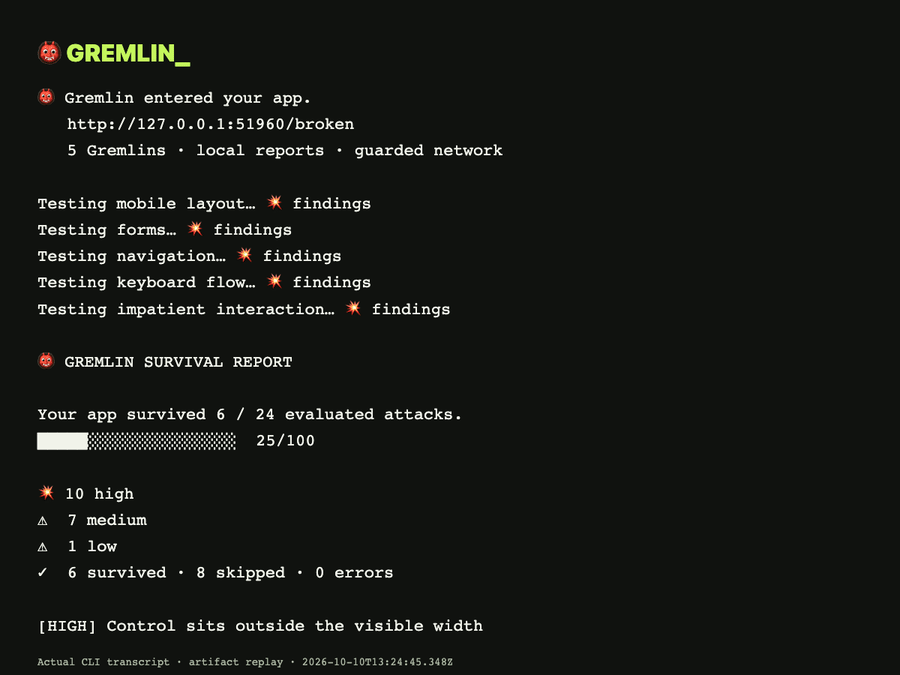
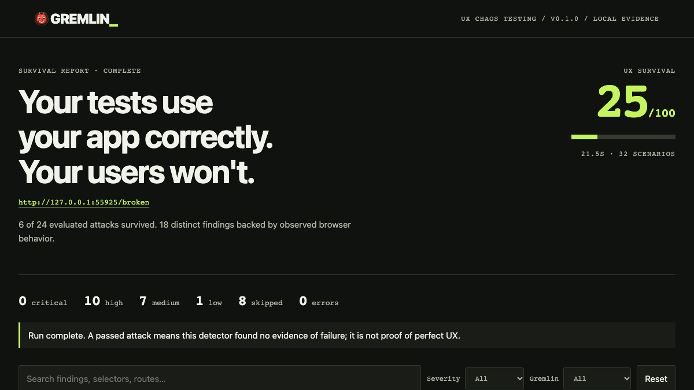

# 👹 GREMLIN

### Find the UX bugs you didn't know to test for.

**Your tests use your app correctly.**<br>
**Your users won't.**



_A real Gremlin demo: one command → five UX attacks → evidence → report. No invented findings or scores._

## Start here

Gremlin is not published to npm yet, so the source install is the verified path today:

```sh
git clone https://github.com/HyperOrb/gremlin-ui.git
cd gremlin-ui
npm ci
```

Want to see it work before pointing it at your own app?

```sh
npm run demo
```

That launches a disposable broken app, attacks it with all five Gremlins, runs the same checks against the fixed version, and writes real reports under `artifacts/`.

Ready to test your own local app? Start your app normally, then run:

```sh
npm run gremlin -- http://localhost:3000
```

Then open `gremlin-report/report.html`. That's the whole basic workflow.

Once the package is published, the same flow becomes:

```sh
npx gremlin-ui http://localhost:3000
```

**What happens after you press Enter:** Gremlin opens a real browser, runs Mobile → Forms → Navigation → Keyboard → Chaos checks, saves screenshot evidence for strong findings, then writes terminal, HTML, and JSON reports locally.

**You can't write a test for a bug you never imagined.**

Gremlin is **UX chaos testing**: fuzz testing, but for UX. It launches a real browser and challenges the assumptions your happy-path tests rely on. What happens at 320px? With an empty form? With only a keyboard? When someone double-clicks because the button gives no reason to wait?

It gives you observed failures, screenshots, selectors, reproduction steps and explanations. It runs locally with **no AI, API key, account, uploads, or analytics**. MIT licensed.

> v0.1.0 is prepared but not published to npm. The npm name was checked, not reserved. The GitHub source-install flow above is verified today.

## Try the real demo

Already cloned the repo? Run:

```sh
npm run demo
```

The demo starts its own server on a free port, runs Gremlin against the **broken and fixed** Fieldnotes app, writes both reports, checks that no writes reached its backend, and stops its own server. On first use Gremlin installs only the Chromium headless shell if needed, with a clear message. Headed runs install the full browser separately. Download time depends on your connection; the under-60-second first-run target is not a guaranteed benchmark.

Open `artifacts/broken/report.html` and `artifacts/fixed/report.html`. Every finding comes from the real browser. Source transcript, comparison JSON and screenshots are kept under `artifacts/`.

## Test your app

Start your local app, then run from this checkout:

```sh
npm run gremlin -- http://localhost:3000
```

Prefer a global local install while npm publishing is pending?

```sh
npm pack
npm install -g ./gremlin-ui-0.1.0.tgz
gremlin http://localhost:3000
```

Once published, `npx gremlin-ui <URL>` will be the simple path. Until then, the checkout/tarball is the verified install route. On Linux, missing OS browser libraries may require `npx playwright install --with-deps chromium`.

```sh
gremlin run http://localhost:3000          # same thing, extra verb
gremlin http://localhost:3000 --mobile
gremlin http://localhost:3000 --gremlin forms,chaos
gremlin http://localhost:3000 --headed
gremlin http://localhost:3000 --output my-report
gremlin http://localhost:3000 --fail-on high
gremlin init                              # optional, never overwrites
gremlin list
```

## What the five Gremlins do

| Gremlin    | Challenge                                             | Useful evidence                                                                         |
| ---------- | ----------------------------------------------------- | --------------------------------------------------------------------------------------- |
| Mobile     | 320, 375, 390px and desktop                           | Horizontal overflow, off-screen controls, fixed overlays covering actions               |
| Forms      | Empty, invalid, whitespace and 1,024-character values | Submit events without recognized validation, input-driven layout failures               |
| Navigation | Links, deep loads, Back, Forward and reload           | HTTP errors, history mismatches, console/runtime errors, inert controls                 |
| Keyboard   | Tab, Shift+Tab, Enter, Escape                         | Missing detected focus indication, unreachable custom controls, pointer-only activation |
| Chaos      | Single vs double click, immediate resize and reload   | Extra identical write attempts, interaction exceptions and broken resulting layouts     |

These are bounded heuristics with documented limits. Medium-confidence observations need manual review. Gremlin does not replace accessibility tools or know your application's business rules. [Read exactly what each detector proves.](docs/detection.md)

Unit tests protect code assumptions. Integration tests protect system assumptions. End-to-end tests protect expected journeys. **Gremlin challenges product assumptions.**

## Evidence first. Mischief second.

Each finding includes a stable ID, rule, category, severity, confidence, affected URL, selector when available, viewport, screenshot, observed metadata, reproduction steps, why it matters, and one short Gremlin line.



```text
gremlin-report/
├── report.html       # local, responsive, severity/category/search filters
├── report.json       # schemaVersion: 1, for agents and CI
├── metadata.json     # configuration, coverage and run timing
└── screenshots/      # actual browser evidence
```

The terminal shows coverage, severity counts and six prioritized findings. HTML and JSON retain all findings. Missing screenshots produce warnings, not fabricated evidence.

**UX Survival = `round(100 × passed / (passed + failed))`.** Skips and errors are excluded. No evaluated attacks means no score. Errors mark coverage incomplete and force exit 2. This is a comparative run metric, not a scientific measurement of UX quality. Compare matching configurations and evaluated coverage, not just scores. [Scoring and reproducibility](docs/detection.md#score).

## Safety that is visible

By default, Gremlin targets localhost. A remote preview requires `--staging`; use only environments you control with disposable data.

Dangerous controls and routes are denied. All HTTP writes, external-origin requests, WebSockets, sendBeacon and WebRTC are blocked; service workers are disabled. Skipped actions and blocked attempts appear in the report. An allowlist cannot override a dangerous-action deny.

**A duplicate-request finding means observed attempts, not proof of duplicate persisted records.** The backend may have idempotency protection. Gremlin returns an explicit safety-block response instead of pretending a write succeeded.

Page code still executes. State-changing GET endpoints, ambiguous labels, and apps requiring external assets/APIs need care; this is not a general sandbox. Use a disposable local app, review the [safety boundaries](docs/safety.md), and keep screenshots private. No security exploitation, purchases or destructive-action testing is built into the CLI.

## Optional configuration and existing sessions

Gremlin works without configuration. `gremlin init` creates `gremlin.config.json`. See [the example](gremlin.config.example.json) for routes, actions, viewports, timeouts and screenshots. Route patterns and action patterns support `*`; matching is case-insensitive. `includeRoutes` adds routes; `excludeRoutes` denies them. Discovery is bounded to entry-page links, with a default maximum of three pages.

```sh
gremlin http://localhost:3000 --config gremlin.config.json
gremlin http://localhost:3000 --storage-state playwright-state.json
```

Use a session you are already authorized to access. Gremlin does not log in, bypass authentication, inject credentials, or export session state. Auth-dependent flows and external redirects may reduce coverage.

## A repair loop for coding agents

**RUN → FIND → INSPECT → FIX → RUN AGAIN → COMPARE**

The bundled [Agent Skill](skills/gremlin/SKILL.md) teaches a shell-capable agent to start your server, read JSON, inspect screenshots, reproduce high-confidence findings, make narrow source fixes and rerun matching attacks. It stops after three repair cycles and explains unresolved findings. A skip is not a fix.

The skill follows the open Agent Skills format. Client-specific installation and limitations are in [the agent guide](docs/agents.md); cross-client execution has not been separately verified. The CLI remains useful without an agent.

## Build your own Gremlin

Implement a small `Gremlin` interface and call `context.test()` for a guarded, isolated browser attack. `attack.find()` handles IDs, screenshots and report linkage. Custom families and reporters can use the exported TypeScript API.

See the [complete example and reporter guide](docs/extensions.md). To contribute a built-in detector, add a real failing/fixed fixture and explain likely false positives. [Contributing](CONTRIBUTING.md).

## Development, CI and demo media

```sh
npm ci
npx playwright install chromium
npm test
npm run format:check
npm run demo:capture   # ffmpeg required; short artifact replay from real demo output
npm pack --dry-run
```

The browser tests verify seeded failures, fixes, stable IDs, screenshots, request guards and report filters/layout. [Demo capture instructions](docs/demo.md) and [CI recipe](docs/ci.md) explain the reproducible workflow.

Current live verification: macOS arm64. An Ubuntu GitHub workflow is supplied; hosted CI and Windows have not yet been run. [Validation record](docs/validation.md).

## Roadmap

1. More fixtures from real applications to reduce focus, history and inert-control false positives.
2. Explicit app-specific oracles for modals and state preservation, with better authenticated-flow coverage.
3. Linux/Windows execution and stable CI comparisons on matching preview coverage.

No cloud dashboard or API keys needed. Future AI enhancements, if added, will be optional.

Independent from [Gremlin's reliability platform](https://www.gremlin.com/product) and [gremlins.js](https://github.com/marmelab/gremlins.js). Naming/landscape notes are in [research](docs/research.md). [MIT License](LICENSE).
